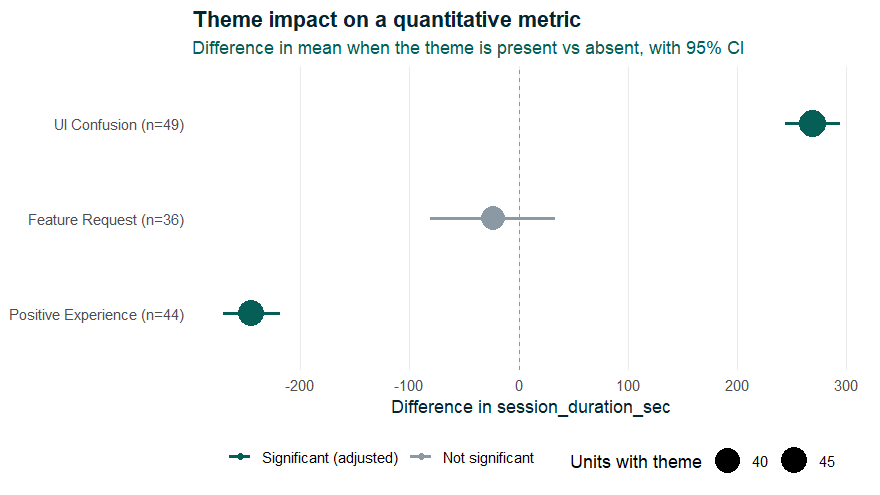

<!-- README.md is generated from README.Rmd. Please edit that file and rebuild with devtools::build_readme() -->

<div align="center">

</div>

# saydo 

<!-- badges: start -->

[](https://github.com/neu-data/saydo/actions/workflows/R-CMD-check.yaml)
[](https://neu-data.github.io/saydo/)
[](https://lifecycle.r-lib.org/articles/stages.html#experimental)

<!-- badges: end -->

**What people say, and what they do.**

saydo measures the *say-do gap*: whether the themes in what people say
(interviews, open survey answers, feedback, support tickets) go with
differences in what they do (session logs, errors, adherence, outcomes).
It codes the text with an LLM, checks that coding against a human, links
the codes to each participant’s quantitative data, and tests every theme
against every metric, in one reproducible R workflow.

LLM coding on its own is already well served:
[quallmer](https://cran.r-project.org/package=quallmer) codes text
against a codebook and validates it thoroughly. What saydo adds is the
step after coding, which MAXQDA offers as “qualitative themes by
quantitative groups” but R has lacked: joining codes to external
participant data, rolling segment codes up to participants, and testing
theme-by-metric differences with adjusted p-values and effect sizes.

    transcripts ──► llm_auto_code() ──► code_agreement()     is the LLM coding reliable?
                           │
    behavioural logs ──────┴──────────► cross_tab_themes()   which themes go with metric shifts?
                                               │
                                               └──► plot_theme_impact()

## Installation

saydo is not on CRAN yet. Install the development version from GitHub:

``` r
# install.packages("remotes")
remotes::install_github("neu-data/saydo")
```

You also need an API key for an LLM provider supported by
[ellmer](https://ellmer.tidyverse.org), for example `OPENAI_API_KEY` or
`ANTHROPIC_API_KEY` in your `.Renviron`.

## Example

The package includes a simulated dataset and an offline keyword coder,
so you can try the whole workflow without an API key.

``` r
library(saydo)

users <- mock_mixed_data(n_users = 120, seed = 42)
users
#> # A tibble: 120 × 5
#>    user_id  profile    session_duration_sec errors_encountered transcript_feedback                  
#>    <chr>    <chr>                     <dbl>              <int> <chr>                                
#>  1 USR-1001 frustrated                  434                  5 The layout changed and now I can't f…
#>  2 USR-1002 frustrated                  475                 11 I got completely lost trying to save…
#>  3 USR-1003 frustrated                  420                 11 Why is the checkout process so confu…
#>  4 USR-1004 frustrated                  477                  4 Why is the checkout process so confu…
#>  5 USR-1005 efficient                   165                  0 Really clean UI. Navigating from the…
#>  6 USR-1006 efficient                   105                  0 The feature works exactly as expecte…
#>  7 USR-1007 efficient                   104                  1 Extremely efficient workflow. Saved …
#>  8 USR-1008 frustrated                  472                 12 This interface is incredibly frustra…
#>  9 USR-1009 casual                      225                  2 Standard performance. Nothing specta…
#> 10 USR-1010 casual                      304                  3 Logged in, checked the system status…
#> # ℹ 110 more rows
```

### 1. Code the text

A codebook maps each code name to a definition. Clear, specific
definitions give much more reliable coding than bare labels.

``` r
codebook <- c(
  UI_Confusion        = "The user reports being lost, confused, or unable to find something in the interface",
  Positive_Experience = "The user expresses satisfaction, praise, or enjoyment of the product",
  Feature_Request     = "The user asks for a feature or capability that does not currently exist"
)
```

``` r
coded <- llm_auto_code(
  users, user_id, transcript_feedback, codebook,
  chat = ellmer::chat_openai(model = "gpt-4.1-mini")
)
```

Each text is coded in its own conversation, so earlier transcripts never
influence later ones. Requests run in parallel (`max_active`), and the
result has one `TRUE`/`FALSE` column per code. Any ellmer chat works,
for example `ellmer::chat_anthropic()`, `ellmer::chat_google_gemini()`,
or a local model through `ellmer::chat_ollama()`.

To run the example offline, swap the LLM for the demo coder. The rest of
this README uses its output:

``` r
coded <- llm_auto_code(users, user_id, transcript_feedback, codebook,
                       coder = mock_coder())
coded[, c("user_id", names(codebook))]
#> # A tibble: 120 × 4
#>    user_id  UI_Confusion Positive_Experience Feature_Request
#>    <chr>    <lgl>        <lgl>               <lgl>          
#>  1 USR-1001 TRUE         FALSE               FALSE          
#>  2 USR-1002 TRUE         FALSE               FALSE          
#>  3 USR-1003 TRUE         FALSE               TRUE           
#>  4 USR-1004 TRUE         FALSE               TRUE           
#>  5 USR-1005 FALSE        TRUE                FALSE          
#>  6 USR-1006 FALSE        TRUE                FALSE          
#>  7 USR-1007 FALSE        TRUE                TRUE           
#>  8 USR-1008 TRUE         FALSE               FALSE          
#>  9 USR-1009 FALSE        FALSE               TRUE           
#> 10 USR-1010 FALSE        FALSE               FALSE          
#> # ℹ 110 more rows
```

### 2. Check the coding against a human

Before analysing the codes, have a person code a random sample of the
texts and compare:

``` r
set.seed(1)
to_check <- coded[sample(nrow(coded), 40), c("user_id", "transcript_feedback")]
# ...a human adds UI_Confusion, Positive_Experience and Feature_Request columns...

code_agreement(coded, human_coded)
```

For each theme you get percent agreement, **Cohen’s kappa** with a
confidence interval, and the LLM’s **precision, recall and F1** against
the human codes. Low recall means the LLM misses the theme, and low
precision means it over-applies it; either is usually fixed by
sharpening the code’s definition. As a rough guide, kappa above 0.6 is
substantial agreement and above 0.8 near-perfect.

### 3. Link the themes to the numbers

``` r
results <- cross_tab_themes(coded, session_duration_sec)
print(results, width = Inf)
#> # A tibble: 3 × 12
#>   theme               n_absent n_present mean_absent mean_present difference conf_low conf_high
#>   <chr>                  <int>     <int>       <dbl>        <dbl>      <dbl>    <dbl>     <dbl>
#> 1 UI_Confusion              71        49        182.         451.      269.     244.      294. 
#> 2 Positive_Experience       76        44        381.         136.     -245.    -271.     -218. 
#> 3 Feature_Request           84        36        299.         275.      -23.8    -81.1      33.6
#>   cohens_d  p_value p_adjusted significant
#>      <dbl>    <dbl>      <dbl> <lgl>      
#> 1    4.04  3.73e-38   1.12e-37 TRUE       
#> 2   -2.72  1.01e-31   1.52e-31 TRUE       
#> 3   -0.160 4.12e- 1   4.12e- 1 FALSE
```

Users who describe UI confusion spend about 269 seconds longer per
session. Feature requests, which the simulation adds at random, should
show no effect.

For each theme, `cross_tab_themes()` runs Welch’s t-test (present vs
absent), reports the mean difference with a 95% confidence interval and
Cohen’s d, and adjusts p-values across themes for multiple comparisons
(Benjamini–Hochberg by default, see `p_adjust`). Themes too rare to test
get `NA` rather than a misleading result.

### 4. Plot it

``` r
plot_theme_impact(results)
```



## Segment-level transcripts

Interview transcripts are often coded by segment, with several rows per
participant, while behavioural metrics have one row per participant.
Code the segments, then pass the participant table as `metrics`:

``` r
coded_segments <- llm_auto_code(segments, participant_id, segment_text, codebook,
                                chat = ellmer::chat_openai())

cross_tab_themes(coded_segments, minutes_active, metrics = participant_logs)
```

A theme counts as present for a participant if it appears in any of
their segments. The codes are then joined to `participant_logs` by
`participant_id`.

## Functions

| Function | Purpose |
|----|----|
| `llm_auto_code()` | Apply a codebook to text with an LLM (or any custom coder) |
| `code_agreement()` | Validate LLM codes against human codes: kappa, precision, recall, F1 |
| `cross_tab_themes()` | Test whether a numeric metric differs when each theme is present |
| `plot_theme_impact()` | Plot metric differences per theme with confidence intervals |
| `mock_mixed_data()` | Simulated users with metrics and feedback text |
| `mock_coder()` | Offline keyword coder for demos and tests |

## Good practice

- **Validate first.** Report `code_agreement()` results alongside any
  analysis. Reviewers will expect to see them.
- **Treat results as associations.** A theme that goes with longer
  sessions does not cause them. `cross_tab_themes()` describes group
  differences and does not adjust for confounders. For that, fit your
  own model on the coded data.
- **Pin the model.** Name the exact model version in `chat` and record
  it, because LLM coding can change between model releases.
- **Mind the data.** Texts are sent to the LLM provider. Check that this
  is allowed under your ethics approval and data agreements, or use a
  local model via `ellmer::chat_ollama()`.

## Learn more

- [Getting
  started](https://neu-data.github.io/saydo/articles/saydo.html): the
  full workflow, including a worked agreement check and segment-level
  coding.
- [quant2qual](https://github.com/neu-data/quant2qual), the companion
  Neudata package, goes the other way: it turns behavioural metrics into
  qualitative case-study prose.

## License

MIT © Neudata Consulting Ltd

------------------------------------------------------------------------

<div align="center">
<strong>Neudata Consulting Ltd</strong> · <em>Insight. Impact. Innovation.</em><br />
<a href="https://www.neu-data.com">www.neu-data.com</a> · <a href="mailto:contact@neu-data.com">contact@neu-data.com</a>
</div>
